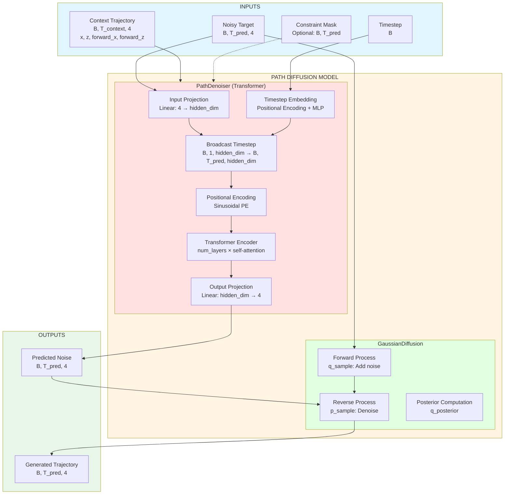
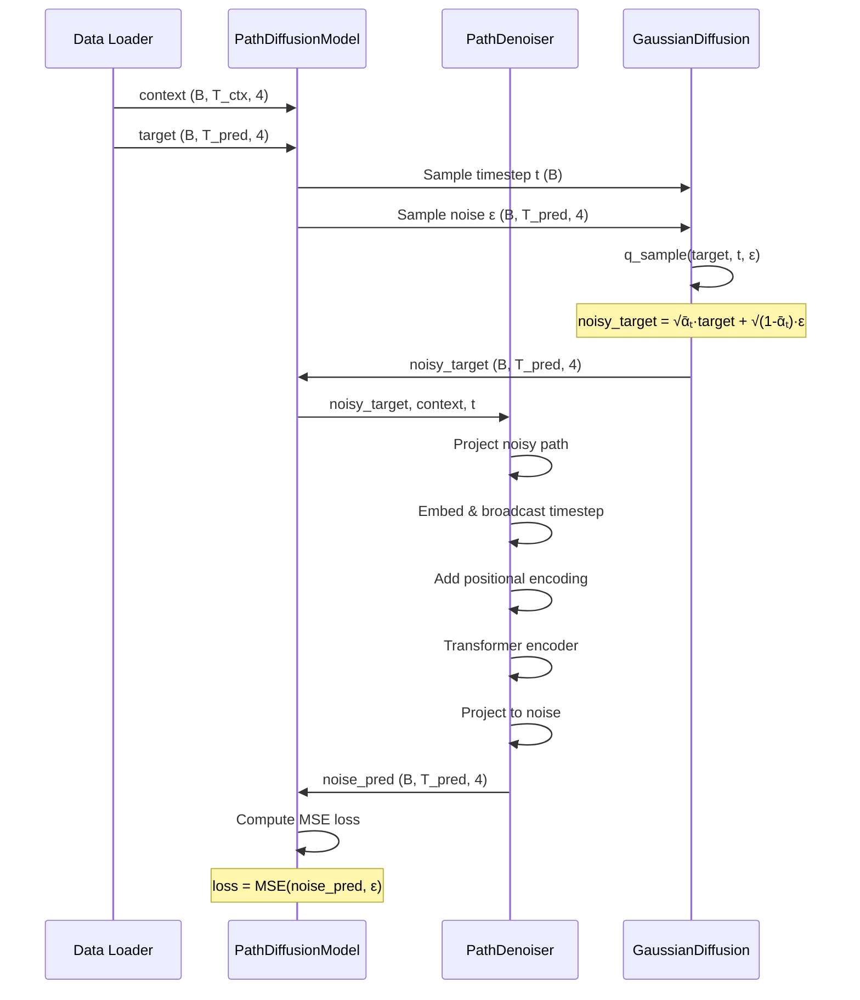
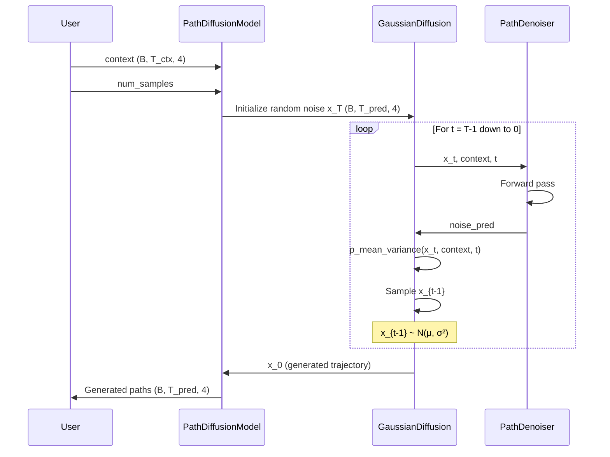
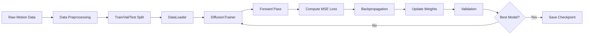
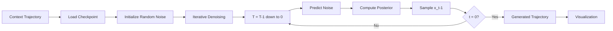

# Path Prediction Diffusion Model - Architecture Diagram

> **Note:** This document was written for an earlier design where the context
> trajectory conditioned the denoiser. The current model is **unconditional** and
> has no context input at all (`context_length` was removed): sequences are
> canonicalized by translating their first point to the origin (plus random
> rotation during training), and control happens only through constraints
> enforced in the diffusion noise (Kimodo-style). At inference, the first-point
> constraint value anchors the canonicalization frame. Mentions of "context
> conditioning" below should be read accordingly.

## High-Level Architecture



## Detailed Data Flow

### Training Mode



### Inference Mode



## Component Details

### 1. PathDenoiser (Transformer-based)

**Inputs:**
- `noisy_path`: (B, T_pred, 4) - noisy trajectory to denoise
- `context`: (B, T_context, 4) - observed context trajectory for conditioning
  - These are the `context_length` frames that the model conditions on
  - Used to guide the denoising process
- `timestep`: (B,) - diffusion timestep
- `constraint_mask`: (B, T_pred) - optional mask for constrained positions
  - Different from context - this constrains specific positions during diffusion
  - When provided, noise is zeroed at constrained positions (Kimodo-style)
  - Not the same as context conditioning

**Output:**
- `noise_pred`: (B, T_pred, 4) - predicted noise

**Architecture:**
```
noisy_path (B, T_pred, 4)
    ↓
Input Linear: 4 → hidden_dim (B, T_pred, hidden_dim)
    ↓
Timestep Embedding + Broadcast (B, T_pred, hidden_dim)
    ↓
Add to noisy path projection (B, T_pred, hidden_dim)
    ↓
Positional Encoding (B, T_pred, hidden_dim)
    ↓
Transformer Encoder (num_layers × self-attention)
    ↓
Output Linear: hidden_dim → 4 (B, T_pred, 4)
    ↓
noise_pred
```

### 2. GaussianDiffusion

**Forward Process (q):**
- `q_sample(x_0, t, noise)`: Add noise to data
  - Input: `x_0` (B, T_pred, 4), `t` (B,), `noise` (B, T_pred, 4)
  - Output: `x_t` (B, T_pred, 4) - noisy data at timestep t

**Reverse Process (p):**
- `p_sample(model, x_t, context, t)`: Denoise one step
  - Input: `model`, `x_t` (B, T_pred, 4), `context` (B, T_context, 4), `t` (B,)
  - Output: `x_{t-1}` (B, T_pred, 4) - less noisy data

- `p_sample_loop(model, context, shape)`: Generate complete sample
  - Input: `model`, `context` (B, T_context, 4), `shape`
  - Output: `x_0` (B, T_pred, 4) - generated trajectory

### 3. PathDiffusionModel (Complete Model)

**Training Forward:**
- `forward(target, context, timestep, constraint_mask)`
  - Input: `target` (B, T_pred, 4), `context` (B, T_context, 4), `timestep` (B,)
  - Output: `noise_pred` (B, T_pred, 4)

**Inference:**
- Uses `diffusion.p_sample_loop()` to generate trajectories

## Input/Output Specifications

### Feature Dimensions (4 features per frame)
- `hips_x`: Hip position in world X
- `hips_z`: Hip position in world Z
- `forward_x`: Forward direction X component (normalized)
- `forward_z`: Forward direction Z component (normalized)

### Tensor Shapes
| Component | Shape | Description |
|-----------|-------|-------------|
| Context | (B, T_context, 4) | Observed past trajectory |
| Target | (B, T_pred, 4) | Ground truth future trajectory, zero-padded to `max_prediction_length` |
| Attention Mask | (B, T_pred) | 1 = valid position, 0 = zero-padding |
| Noisy Target | (B, T_pred, 4) | Noisy version of target |
| Timestep | (B,) | Diffusion timestep |
| Constraint Mask | (B, T_pred) | Optional constraint mask (hard constraints) |
| Noise Prediction | (B, T_pred, 4) | Predicted noise |
| Generated Trajectory | (B, T_pred, 4) | Final output |

**Note**: `T_pred` is always `max_prediction_length` (padded size); each sample's true length is given by `actual_length`.

### Training Parameters

#### Data Parameters
- `--data_dir`: Directory containing preprocessed data files (default: `./data`)
  - Should contain `root_feature_matrix.npy`
- `--motion_data_dir`: Directory containing motion capture data (default: `../motion_2/data`)
  - Should contain `clip_frame_ranges_world.pkl`
- `--context_length`: Number of context frames to observe (default: `30`)
  - Frames from the past that the model conditions on
  - These are **conditioning inputs**, not constrained inputs
  - The model uses these to predict future trajectories
  - Typical range: 10-60 frames depending on motion complexity
- `--min_prediction_length`: Minimum prediction length per sample (default: `20`)
  - Each training sample draws a random length in `[min, max]`
  - Set equal to `--max_prediction_length` for fixed-length behavior
- `--max_prediction_length`: Maximum prediction length (default: `600`)
  - Determines the zero-padded tensor size used for batching
  - `max_seq_len` is set to `context_length + max_prediction_length`
  - An `attention_mask` (1=valid, 0=padding) prevents attention to padded positions
  - The loss is masked so padding does not contribute to training

#### Model Architecture Parameters
- `--hidden_dim`: Hidden dimension for transformer layers (default: `256`)
  - Controls model capacity and representational power
  - Higher values increase model size and computation
  - Typical range: 128-512
- `--num_layers`: Number of transformer encoder layers (default: `6`)
  - Depth of the neural network
  - More layers can capture more complex patterns but increase computation
  - Typical range: 4-12
- `--num_heads`: Number of attention heads in transformer (default: `8`)
  - Multi-head attention mechanism parameter
  - Must divide hidden_dim evenly
  - Typical range: 4-16
- `--dropout`: Dropout rate for regularization (default: `0.1`)
  - Probability of dropping units during training
  - Helps prevent overfitting
  - Typical range: 0.0-0.3
- `--num_timesteps`: Number of diffusion timesteps (default: `1000`)
  - T in the diffusion process
  - More timesteps can improve quality but slow down training/inference
  - Typical range: 100-1000

#### Training Optimization Parameters
- `--batch_size`: Batch size for training (default: `32`)
  - Number of samples per gradient update
  - Larger batches provide more stable gradients but require more memory
  - Typical range: 16-128 depending on GPU memory
- `--num_epochs`: Number of training epochs (default: `100`)
  - Complete passes through the training dataset
  - More epochs generally improve performance up to a point
  - Typical range: 50-500
- `--learning_rate`: Learning rate for optimizer (default: `1e-4`)
  - Step size for gradient updates
  - Too high can cause instability, too slow can cause slow convergence
  - Typical range: 1e-5 to 1e-3
- `--weight_decay`: L2 regularization weight (default: `1e-6`)
  - Penalizes large weights to prevent overfitting
  - Applied via AdamW optimizer
  - Typical range: 1e-7 to 1e-5

#### Learning Rate Scheduler Parameters
- `T_max`: Maximum number of iterations for cosine annealing (default: `1000`)
  - Controls the period of the cosine learning rate schedule
  - Set in the scheduler configuration
- `eta_min`: Minimum learning rate (default: `1e-6`)
  - Lower bound for learning rate during cosine annealing
  - Prevents learning rate from becoming too small

#### Device and Checkpoint Parameters
- `--device`: Device to use for training (default: `cuda`)
  - Options: `cuda` for GPU, `cpu` for CPU
  - Automatically falls back to CPU if CUDA unavailable
- `--save_dir`: Directory for saving checkpoints (default: `./checkpoints`)
  - Model checkpoints and normalization stats are saved here
- `--resume`: Path to checkpoint for resuming training (default: `None`)
  - Allows training to continue from a saved state
  - Includes model weights, optimizer state, and training progress
- `--val_every`: Validate every N epochs (default: `1`)
  - Frequency of validation during training
  - More frequent validation provides better monitoring but slows training
- `--save_every`: Save checkpoint every N epochs (default: `10`)
  - Frequency of periodic checkpoint saves
  - Provides recovery points in case of training interruption

#### Fixed Model Parameters
- `feature_dim`: Input feature dimension (fixed: `4`)
  - [hips_x, hips_z, forward_x, forward_z]
- `pe_dropout`: Positional encoding dropout (same as `--dropout`)
  - Dropout applied after positional encoding
- `norm_first`: Pre-norm vs post-norm in transformer (fixed: `False`)
  - Post-norm architecture (LayerNorm after attention/FFN)
- `beta_schedule`: Noise schedule type (fixed: `linear`)
  - Linear schedule from beta_start to beta_end
  - Alternative: `cosine` schedule available in model

#### Diffusion Noise Schedule Parameters
- `beta_start`: Starting noise schedule value (fixed: `0.0001`)
  - Initial beta value for linear schedule
  - Controls how much noise is added at early timesteps
- `beta_end`: Ending noise schedule value (fixed: `0.02`)
  - Final beta value for linear schedule
  - Controls how much noise is added at late timesteps
- Noise schedule determines how aggressively data is corrupted during forward diffusion
- Linear schedule: betas increase linearly from beta_start to beta_end
- Cosine schedule: betas follow a cosine curve (potentially better quality)

### Example Training Commands

#### Basic Training (Default Parameters)
```bash
python train.py \
    --data_dir ./data \
    --motion_data_dir ../motion_2/data \
    --context_length 30 \
    --min_prediction_length 20 \
    --max_prediction_length 600 \
    --batch_size 32 \
    --num_epochs 100 \
    --learning_rate 1e-4 \
    --hidden_dim 256 \
    --num_layers 6 \
    --num_heads 8 \
    --num_timesteps 1000 \
    --save_dir ./checkpoints
```

#### Fixed-Length Training (min == max)
```bash
python train.py \
    --data_dir ./data \
    --motion_data_dir ../motion_2/data \
    --context_length 30 \
    --min_prediction_length 60 \
    --max_prediction_length 60 \
    --batch_size 32 \
    --num_epochs 100 \
    --learning_rate 1e-4 \
    --hidden_dim 256 \
    --num_layers 6 \
    --num_heads 8 \
    --num_timesteps 1000 \
    --save_dir ./checkpoints
```

#### Quick Training (Smaller Model, Fewer Epochs)
```bash
python train.py \
    --data_dir ./data \
    --motion_data_dir ../motion_2/data \
    --context_length 20 \
    --min_prediction_length 15 \
    --max_prediction_length 60 \
    --batch_size 64 \
    --num_epochs 50 \
    --learning_rate 2e-4 \
    --hidden_dim 128 \
    --num_layers 4 \
    --num_heads 4 \
    --num_timesteps 500 \
    --save_dir ./checkpoints
```

#### High-Quality Training (Larger Model, More Timesteps)
```bash
python train.py \
    --data_dir ./data \
    --motion_data_dir ../motion_2/data \
    --context_length 30 \
    --min_prediction_length 20 \
    --max_prediction_length 600 \
    --batch_size 16 \
    --num_epochs 200 \
    --learning_rate 5e-5 \
    --hidden_dim 512 \
    --num_layers 8 \
    --num_heads 8 \
    --num_timesteps 1000 \
    --dropout 0.15 \
    --save_dir ./checkpoints
```

#### Resume Training from Checkpoint
```bash
python train.py \
    --data_dir ./data \
    --motion_data_dir ../motion_2/data \
    --context_length 30 \
    --min_prediction_length 20 \
    --max_prediction_length 600 \
    --batch_size 32 \
    --num_epochs 100 \
    --learning_rate 1e-4 \
    --hidden_dim 256 \
    --num_layers 6 \
    --num_heads 8 \
    --num_timesteps 1000 \
    --save_dir ./checkpoints \
    --resume ./checkpoints/epoch_50.pt
```

#### CPU Training (for debugging)
```bash
python train.py \
    --data_dir ./data \
    --motion_data_dir ../motion_2/data \
    --context_length 30 \
    --min_prediction_length 20 \
    --max_prediction_length 60 \
    --batch_size 16 \
    --num_epochs 10 \
    --learning_rate 1e-4 \
    --hidden_dim 128 \
    --num_layers 4 \
    --num_heads 4 \
    --num_timesteps 100 \
    --device cpu \
    --save_dir ./checkpoints
```

#### Inference (any length up to the trained max)
```bash
# Predict 45 frames using a model trained with max_prediction_length=600
python inference.py \
    --checkpoint ./checkpoints/best_model.pt \
    --norm_stats ./checkpoints/normalization_stats.npy \
    --prediction_length 45 \
    --max_prediction_length 600 \
    --num_samples 10 \
    --visualize
```

### Parameter Tuning Guidelines

#### Memory Constraints
- **Reduce batch size** if running out of GPU memory
- **Reduce hidden_dim** to decrease model size
- **Reduce num_layers** to decrease model depth
- **Reduce num_timesteps** to speed up training (with potential quality loss)

#### Training Speed
- **Reduce num_timesteps** for faster iterations (e.g., 100-500)
- **Reduce num_layers** for faster forward/backward passes
- **Increase batch size** for better GPU utilization (if memory allows)
- **Reduce context_length/max_prediction_length** for shorter sequences

#### Model Quality
- **Increase hidden_dim** for more representational capacity
- **Increase num_layers** for deeper hierarchical processing
- **Increase num_timesteps** for finer-grained diffusion (typically 1000)
- **Train for more epochs** for better convergence
- **Use cosine schedule** (modify code) for potentially better quality

#### Overfitting Prevention
- **Increase dropout** (0.1-0.3) for more regularization
- **Increase weight_decay** (1e-6 to 1e-4) for stronger L2 regularization
- **Reduce model capacity** (hidden_dim, num_layers) if dataset is small
- **Use data augmentation** if available
- **Monitor validation loss** and use early stopping

## Training Pipeline



## Inference Pipeline



## Key Algorithms

### DDPM Training
1. Sample random timestep t ~ Uniform(0, T)
2. Sample noise ε ~ N(0, I)
3. Compute noisy target: x_t = √ᾱₜ·x_0 + √(1-ᾱₜ)·ε
4. Predict noise: ε_θ = model(x_t, context, t)
5. Minimize loss: L = MSE(ε_θ, ε)

### DDPM Sampling
1. Start with random noise x_T ~ N(0, I)
2. For t = T-1 down to 0:
   - Predict noise: ε_θ = model(x_t, context, t)
   - Compute posterior: q(x_{t-1} | x_t, x_0)
   - Sample: x_{t-1} ~ q(x_{t-1} | x_t, x_0)
3. Return x_0 as generated sample

## Model Training Process - Pseudocode

### Main Training Loop

```
# Initialize model components with training parameters
model = PathDiffusionModel(
    feature_dim = 4,                    # Fixed: [hips_x, hips_z, forward_x, forward_z]
    hidden_dim = 256,                   # Model capacity (128-512 typical)
    num_layers = 6,                     # Transformer depth (4-12 typical)
    num_heads = 8,                      # Attention heads (must divide hidden_dim)
    num_timesteps = 1000,               # Diffusion steps (100-1000 typical)
    dropout = 0.1,                      # Regularization (0.0-0.3 typical)
    pe_dropout = 0.1,                   # Positional encoding dropout
    norm_first = False,                # Post-norm architecture
    beta_schedule = 'linear',           # Noise schedule type
    device = 'cuda'                     # Training device
)

optimizer = AdamW(
    model.parameters(),
    lr = 1e-4,                          # Learning rate (1e-5 to 1e-3 typical)
    weight_decay = 1e-6                 # L2 regularization (1e-7 to 1e-5 typical)
)

scheduler = CosineAnnealingLR(
    optimizer,
    T_max = 1000,                       # Scheduler period
    eta_min = 1e-6                      # Minimum learning rate
)

# Load and preprocess data with correct parameters
train_loader, val_loader, test_loader, norm_stats = prepare_datasets(
    root_features_path = './data/root_feature_matrix.npy',     # Path to feature matrix
    clip_ranges_path = '../motion_2/data/clip_frame_ranges_world.pkl',  # Path to clip ranges
    context_length = 30,                 # Number of context frames to observe
    min_prediction_length = 20,          # Minimum prediction length per sample
    max_prediction_length = 600,         # Maximum prediction length (padded size)
    batch_size = 32                      # Batch size for data loading
)

best_val_loss = infinity
global_step = 0
current_epoch = 0

for epoch in range(current_epoch, num_epochs):
    # Training phase
    model.train()
    epoch_loss = 0
    
    for batch in train_loader:
        context = batch['context']              # (B, T_context, 4)
        target = batch['target']                # (B, T_pred, 4), zero-padded if variable-length
        attention_mask = batch['attention_mask'] # (B, T_pred): 1=valid, 0=padding
        actual_length = batch['actual_length']   # (B,) true prediction length per sample
        batch_size = context.shape[0]
        
        # Sample random timesteps for each sample in batch
        timesteps = random_integers(0, num_timesteps, size=(batch_size,))
        
        # Sample random noise
        noise = standard_normal(target.shape)
        
        # Forward diffusion: add noise to target
        noisy_target = q_sample(target, timesteps, noise)
        # noisy_target = sqrt(alpha_cumprod[t]) * target + sqrt(1 - alpha_cumprod[t]) * noise
        
        # Model forward pass: predict noise (attention_mask prevents attending to padding)
        noise_pred = model(noisy_target, context, timesteps, attention_mask=attention_mask)
        
        # Compute MASKED MSE loss - padded positions don't contribute
        mask_expanded = attention_mask.unsqueeze(-1).expand_as(noise_pred)
        loss = sum((noise_pred * mask_expanded - noise * mask_expanded)^2) / sum(mask_expanded)
        
        # Backpropagation
        optimizer.zero_grad()
        loss.backward()
        
        # Gradient clipping (max_norm = 1.0)
        clip_gradients(model.parameters(), max_norm = 1.0)
        
        # Update weights
        optimizer.step()
        scheduler.step()
        
        epoch_loss += loss.item()
    
    train_loss = epoch_loss / len(train_loader)
    
    # Validation phase (controlled by val_every parameter)
    if (epoch + 1) % val_every == 0:
        model.eval()
        val_loss = 0
        
        with no_gradient():
            for batch in val_loader:
                context = batch['context']
                target = batch['target']
                batch_size = context.shape[0]
                
                timesteps = random_integers(0, num_timesteps, size=(batch_size,))
                noise = standard_normal(target.shape)
                noisy_target = q_sample(target, timesteps, noise)
                noise_pred = model(noisy_target, context, timesteps)
                loss = mean_squared_error(noise_pred, noise)
                val_loss += loss.item()
        
        val_loss = val_loss / len(val_loader)
        
        # Save best model
        if val_loss < best_val_loss:
            best_val_loss = val_loss
            save_checkpoint(model, optimizer, scheduler, 'best_model.pt')
    
    # Save periodic checkpoint (controlled by save_every parameter)
    if (epoch + 1) % save_every == 0:
        save_checkpoint(model, optimizer, scheduler, f'epoch_{epoch}.pt')
```

### Detailed Training Step Pseudocode

```
FUNCTION compute_training_loss(model, batch, diffusion):
    """
    Compute diffusion training loss for a single batch
    """
    context = batch['context']      # (B, T_context, 4) - conditioning frames
    target = batch['target']        # (B, T_pred, 4) - frames to predict
    batch_size = context.shape[0]
    num_timesteps = diffusion.num_timesteps

    # Step 1: Sample random timestep for each sample (0 to num_timesteps-1)
    timesteps = random_uniform_integers(0, num_timesteps, (batch_size,))

    # Step 2: Sample random noise
    noise = standard_normal(target.shape)  # (B, T_pred, 4)

    # Step 3: Apply constraint mask if provided (Kimodo-style)
    # Note: constraint_mask is different from context!
    # - context: conditioning information (observed past frames)
    # - constraint_mask: optional mask for constraining specific positions during diffusion
    if constraint_mask is not None:
        noise = noise * (1 - constraint_mask.unsqueeze(-1))

    # Step 4: Forward diffusion - add noise to target
    noisy_target = diffusion.q_sample(target, timesteps, noise)
    # Implementation:
    # sqrt_alpha_cumprod_t = extract(diffusion.sqrt_alphas_cumprod, timesteps, target.shape)
    # sqrt_one_minus_alpha_cumprod_t = extract(diffusion.sqrt_one_minus_alphas_cumprod, timesteps, target.shape)
    # noisy_target = sqrt_alpha_cumprod_t * target + sqrt_one_minus_alpha_cumprod_t * noise

    # Step 5: Model forward pass - predict noise
    # Context is used for conditioning, not as constraints
    noise_pred = model(noisy_target, context, timesteps)
    # Implementation:
    # - Project noisy_path: (B, T_pred, 4) -> (B, T_pred, hidden_dim)
    # - Embed timestep: (B,) -> (B, 1, hidden_dim) -> (B, T_pred, hidden_dim)
    # - Add timestep embedding to projected path
    # - Add positional encoding
    # - Pass through transformer encoder
    # - Project back: (B, T_pred, hidden_dim) -> (B, T_pred, 4)

    # Step 6: Compute MSE loss
    loss = mean_squared_error(noise_pred, noise)

    return loss
```

### Forward Diffusion Process (q_sample)

```
FUNCTION q_sample(x_start, timesteps, noise):
    """
    Forward diffusion: add noise to data according to schedule
    x_start: (B, T, 4) - clean data
    timesteps: (B,) - diffusion timesteps
    noise: (B, T, 4) - noise to add
    """
    # Extract precomputed values for given timesteps
    sqrt_alpha_cumprod_t = extract(sqrt_alphas_cumprod, timesteps, x_start.shape)
    sqrt_one_minus_alpha_cumprod_t = extract(sqrt_one_minus_alphas_cumprod, timesteps, x_start.shape)
    
    # Apply noise schedule
    noisy_x = sqrt_alpha_cumprod_t * x_start + sqrt_one_minus_alpha_cumprod_t * noise
    
    return noisy_x
```

### Model Forward Pass (PathDenoiser)

```
FUNCTION path_denoiser_forward(noisy_path, context, timestep, attention_mask=None):
    """
    Transformer-based denoiser forward pass
    noisy_path: (B, T_pred, 4) - may be zero-padded in variable-length mode
    context: (B, T_context, 4)
    timestep: (B,)
    attention_mask: (B, T_pred) optional - 1=valid position, 0=padding
    """
    # Step 1: Project noisy path to hidden dimension
    noisy_proj = linear_layer(noisy_path)  # (B, T_pred, 4) -> (B, T_pred, hidden_dim)
    
    # Step 2: Embed timestep using positional encoding + MLP
    time_embedding = positional_encoding[timestep]  # (B, hidden_dim)
    time_embedding = mlp(time_embedding)  # (B, hidden_dim) -> (B, hidden_dim)
    time_embedding = time_embedding.unsqueeze(1)  # (B, 1, hidden_dim)
    
    # Step 3: Broadcast timestep embedding across sequence (Kimodo-style)
    time_embedding = time_embedding.expand(-1, T_pred, -1)  # (B, T_pred, hidden_dim)
    
    # Step 4: Add timestep embedding to projected path
    x = noisy_proj + time_embedding  # (B, T_pred, hidden_dim)
    
    # Step 5: Add sinusoidal positional encoding
    x = x + positional_encoding[:T_pred, :]  # (B, T_pred, hidden_dim)
    x = dropout(x, p = pe_dropout)
    
    # Step 6: Convert attention mask to transformer key_padding_mask
    # attention_mask: 1=valid, 0=padding -> key_padding_mask: True=ignore
    if attention_mask is not None:
        key_padding_mask = (attention_mask == 0)
    else:
        key_padding_mask = None
    
    # Step 7: Pass through transformer encoder (num_layers)
    # key_padding_mask prevents attending to padded positions
    x = transformer_encoder(x, src_key_padding_mask=key_padding_mask)
    
    # Step 8: Project back to feature dimension
    noise_pred = output_linear(x)  # (B, T_pred, hidden_dim) -> (B, T_pred, 4)
    
    return noise_pred
```

### Validation Step

```
FUNCTION validate(model, val_loader, diffusion):
    """
    Validate model on validation set
    """
    model.eval()
    total_loss = 0
    num_batches = 0
    
    with no_gradient():
        for batch in val_loader:
            context = batch['context']
            target = batch['target']
            batch_size = context.shape[0]
            
            # Sample random timesteps
            timesteps = random_uniform_integers(0, diffusion.num_timesteps, (batch_size,))
            
            # Sample noise and create noisy target
            noise = standard_normal(target.shape)
            noisy_target = diffusion.q_sample(target, timesteps, noise)
            
            # Predict noise
            noise_pred = model(noisy_target, context, timesteps)
            
            # Compute loss
            loss = mean_squared_error(noise_pred, noise)
            total_loss += loss.item()
            num_batches += 1
    
    return total_loss / num_batches
```

### Checkpoint Management

```
FUNCTION save_checkpoint(model, optimizer, scheduler, epoch, best_val_loss, filename):
    """
    Save model training state
    """
    checkpoint = {
        'epoch': epoch,
        'model_state_dict': model.state_dict(),
        'optimizer_state_dict': optimizer.state_dict(),
        'scheduler_state_dict': scheduler.state_dict(),
        'best_val_loss': best_val_loss
    }
    save(checkpoint, filename)

FUNCTION load_checkpoint(model, optimizer, scheduler, filename):
    """
    Load model training state
    """
    checkpoint = load(filename)
    model.load_state_dict(checkpoint['model_state_dict'])
    optimizer.load_state_dict(checkpoint['optimizer_state_dict'])
    scheduler.load_state_dict(checkpoint['scheduler_state_dict'])
    return checkpoint['epoch'], checkpoint['best_val_loss']
```

### Key Training Components

1. **Noise Schedule**: Linear or cosine schedule controlling how much noise is added at each timestep
2. **Timestep Sampling**: Random timestep selection for each training sample
3. **Noise Prediction**: Model learns to predict the noise that was added
4. **Simple Objective**: MSE loss between predicted and actual noise (masked over valid positions in variable-length mode)
5. **Variable-Length Training** (optional): Random prediction lengths per sample, zero-padded to `max_prediction_length` with attention masks
6. **Attention Masking**: Prevents transformer from attending to zero-padded positions (`src_key_padding_mask`)
7. **Teacher Forcing**: During training, model sees ground truth with added noise
8. **Gradient Clipping**: Prevent exploding gradients during training
9. **Learning Rate Scheduling**: Cosine annealing for stable training
10. **Validation**: Periodic evaluation to prevent overfitting

### Important Distinction: Context vs Constraints

**Context (conditioning inputs):**
- Defined by `--context_length` parameter (default: 30 frames)
- These are observed past frames that the model conditions on
- Used to guide the denoising process during training and inference
- The model learns: "Given this past motion, predict the future motion"
- Always provided as input to the model during both training and inference
- Example: First 30 frames of a walking sequence

**Constraints (optional constraint mask):**
- Defined by optional `constraint_mask` parameter
- These are specific positions that must remain fixed during diffusion
- When provided, noise is zeroed at constrained positions (Kimodo-style)
- Used to enforce hard constraints on specific outputs
- Not the same as context - context is for conditioning, constraints are for fixing values
- Optional and not commonly used in standard training
- Example: Force the final position to match a specific target

**Key Differences:**
- Context frames are **conditioning information** (past observations)
- Constraint masks are **hard constraints** on the output generation process
- Context is always used (via `--context_length`)
- Constraints are optional and rarely used in standard training
- Context helps the model understand what to predict
- Constraints force specific positions to remain fixed during diffusion
